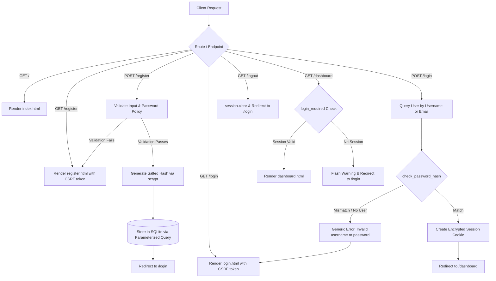

# Cybersecurity Authentication Toolkit

A beginner-friendly, secure web application prototype built with **Python**, **Flask**, and **SQLite**. This project demonstrates the core cybersecurity principles and defense mechanisms required to design, implement, and maintain a secure user authentication system without relying on third-party black-box services.

---

## Table of Contents
1. [Project Overview](#project-overview)
2. [Problem Statement](#problem-statement)
3. [Objectives](#objectives)
4. [Features Implemented](#features-implemented)
5. [Technologies and Libraries Used](#technologies-and-libraries-used)
6. [Project Folder Structure](#project-folder-structure)
7. [Installation and Setup Instructions](#installation-and-setup-instructions)
8. [How to Run the Project](#how-to-run-the-project)
9. [Explanation of How the Code Works](#explanation-of-how-the-code-works)
10. [Automated Testing](#automated-testing)
11. [Screenshots](#screenshots)
12. [Security Considerations and Limitations](#security-considerations-and-limitations)
13. [Future Improvements](#future-improvements)

---

## Project Overview

The **Cybersecurity Authentication Toolkit** is an educational, hands-on web application designed to demonstrate fundamental web security and authentication concepts. Rather than outsourcing user authentication to external cloud identity providers (such as Firebase, Auth0, or Supabase), this application builds a secure authentication system from the ground up using standard Python libraries and Flask.

It illustrates how web applications can safeguard user credentials, defend against common attack vectors like **SQL Injection (SQLi)** and **Cross-Site Request Forgery (CSRF)**, enforce strong password policies, and protect user sessions using industry-standard best practices.

---

## Problem Statement

Authentication and credential storage vulnerabilities remain among the most critical security flaws in modern web development:
- **Plaintext and Weak Password Storage**: Storing passwords in plaintext or using outdated, fast hashing algorithms (such as MD5 or SHA-1 without salt) allows attackers to compromise all user accounts immediately if database files are leaked or accessed through SQL injection.
- **SQL Injection**: Improperly sanitized user input concatenated directly into SQL queries can allow attackers to bypass authentication or extract sensitive database contents.
- **Account Enumeration**: Detailed error messages (such as *"Username does not exist"* or *"Incorrect password for user"*) allow malicious actors to enumerate and harvest valid usernames and email addresses.
- **Session Hijacking and Tampering**: Sessions lacking proper cookie attributes (`HttpOnly`, `SameSite`) can be hijacked via Cross-Site Scripting (XSS) or manipulated via Cross-Site Request Forgery (CSRF).

Many beginner developers rely on automated authentication tools without understanding what happens under the hood. This project bridges that gap by providing a transparent, well-documented implementation of these defenses.

---

## Objectives

- **Cryptographic Protection**: Demonstrate salted, one-way password hashing using standard key-derivation functions (`scrypt` / `PBKDF2`) to make dictionary and rainbow table attacks infeasible.
- **Input Validation & Policy Enforcement**: Enforce NIST-recommended password complexity requirements with interactive client-side feedback and strict server-side validation.
- **Database Security**: Guarantee SQL injection defense by using parameterized prepared statements for all database operations with SQLite.
- **User Privacy & Reconnaissance Defense**: Implement generic authentication error handling to prevent username/email enumeration.
- **Session Management**: Implement secure, cookie-based session handling with access control decorators (`@login_required`) and explicit session termination (`session.clear()`).
- **CSRF Defense**: Generate and validate cryptographically secure, per-session anti-CSRF tokens for all state-changing POST requests.
- **Simplicity & Portability**: Create a standalone prototype that runs locally on any computer without paid dependencies, API keys, or external database setups.

---

## Features Implemented

### 1. Landing Page (`/`)
- A modern, cybersecurity-themed dashboard landing page.
- Clear explanations of core authentication concepts and OWASP defense categories.
- Direct navigation buttons for **Register**, **Login**, and **Dashboard** (context-aware based on current session state).

### 2. User Registration (`/register`)
- Input fields for **Username**, **Email Address**, **Password**, and **Confirm Password**.
- Server-side validation:
  - Username presence and format validation.
  - Email format validation using regular expressions.
  - Password match verification.
  - Enforced password complexity rules (length, uppercase, lowercase, numbers, symbols).
  - Duplicate account prevention: checks whether the username or email is already taken.
- Automatic one-way password hashing prior to database insertion.

### 3. Interactive Password Strength Checker (Client-Side)
- Real-time client-side evaluation of password complexity as the user types.
- Visual strength badge updating across **Weak**, **Medium**, and **Strong** states.
- Dynamic color-coded progress bar (Red $\rightarrow$ Amber $\rightarrow$ Green).
- Live requirements checklist with checkmarks (`✓`) and crosses (`✕`):
  - At least 8 characters
  - At least one uppercase letter (`A-Z`)
  - At least one lowercase letter (`a-z`)
  - At least one number (`0-9`)
  - At least one special character (`!@#$%^&*...`)
- Real-time password confirmation matching indicator.
- Show/Hide password toggle buttons for usability.

### 4. User Login & Authentication (`/login`)
- Supports logging in with either **Username** or **Email Address**.
- Constant-time password hash verification via `check_password_hash()`.
- **Anti-User Enumeration**: Failed login attempts return a uniform error message (*"Invalid username or password."*) regardless of whether the identifier exists or the password was incorrect.
- Successful login generates a fresh authenticated session and redirects to the user dashboard.

### 5. Session Management & Access Control (`/dashboard`, `/logout`)
- Protected route (`/dashboard`) guarded by a custom `@login_required` decorator.
- Unauthenticated requests are intercepted and redirected to `/login` with an informative warning message.
- Session cookie attributes configured for security:
  - `SESSION_COOKIE_HTTPONLY = True`: Blocks JavaScript from reading the session cookie (defending against XSS cookie theft).
  - `SESSION_COOKIE_SAMESITE = 'Lax'`: Mitigates Cross-Site Request Forgery risks.
- Explicit logout route (`/logout`) that invokes `session.clear()`, wiping session data from both client and server state.

### 6. CSRF Protection
- Generates a cryptographically random token (`secrets.token_hex(24)`) per session.
- Automatically injects the token into all rendered forms via Flask's context processor.
- Validates the submitted token on every HTTP `POST` request before processing any user data.

### 7. User Dashboard (`/dashboard`)
- Displays personalized welcome message: *"Welcome, [username]"*.
- Summarizes current session parameters:
  - Authentication status (Verified / Active).
  - Username and registered email.
  - Current session login timestamp and account registration timestamp.
- Educational reference section detailing the active security mechanisms protecting the active session.

---

## Technologies and Libraries Used

| Technology / Library | Version | Purpose in Project |
|---|---|---|
| **Python** | 3.10+ | Primary backend programming language |
| **Flask** | 3.1.3 | Lightweight WSGI web application framework, routing, and session management |
| **Werkzeug** | 3.1.8 | Cryptographic hashing utilities (`generate_password_hash`, `check_password_hash`) |
| **SQLite3** | Built-in | Embedded relational database management system storing user data |
| **HTML5 & Jinja2** | Built-in | Template inheritance, dynamic content rendering, form handling |
| **CSS3** | Custom | Responsive cybersecurity dark theme, card styling, and visual indicators |
| **JavaScript** | Vanilla ES6 | Real-time DOM manipulation for password strength calculation and UI toggles |
| **unittest** | Built-in | Python automated test framework for running validation and security tests |

---

## Project Folder Structure

```
Authentication Toolkit/
│
├── app.py                  # Main Flask application (routes, security controls, DB logic)
├── database.db             # Local SQLite database storing user records (auto-created)
├── requirements.txt        # Python dependency manifest (Flask)
├── test_auth.py            # Comprehensive automated test suite (10 unit tests)
├── README.md               # Complete project documentation
│
├── templates/              # Jinja2 HTML templates
│   ├── base.html           # Base layout with navbar, alerts, and footer
│   ├── index.html          # Landing page with security overviews and feature cards
│   ├── register.html       # Registration form with dynamic password strength meter
│   ├── login.html          # Login form with anti-enumeration protection
│   └── dashboard.html      # Protected user dashboard displaying session information
│
└── static/                 # Static web assets
    ├── style.css           # Cybersecurity-themed dark mode stylesheet
    └── script.js           # Client-side password strength checker and UI interaction logic
```

---

## Installation and Setup Instructions

### Prerequisites
- **Python 3.10** or higher installed on your system.
- Basic terminal or command prompt access.

### Step 1: Open the Project Directory
Open your terminal or command prompt and navigate to the project directory:

```bash
cd "Authentication Toolkit"
```

### Step 2: Create a Virtual Environment (Recommended)
Creating an isolated virtual environment prevents conflicts with globally installed Python packages.

**On Windows:**
```bash
python -m venv .venv
.venv\Scripts\activate
```

**On macOS / Linux:**
```bash
python3 -m venv .venv
source .venv/bin/activate
```

### Step 3: Install Required Dependencies
Install Flask using the provided `requirements.txt` file:

```bash
pip install -r requirements.txt
```

---

## How to Run the Project

### 1. Start the Flask Server
Run the `app.py` script from the project root:

```bash
python app.py
```

You will see output confirming that the development server is active:
```
 * Serving Flask app 'app'
 * Debug mode: on
 * Running on http://127.0.0.1:5000
```

> **Note:** The auto-reloader is intentionally set to `use_reloader=False` in `app.run()` to ensure stable local execution and prevent unnecessary reload loops when virtual environments reside within the project directory.

### 2. Access the Application
Open your web browser and visit:
```
http://127.0.0.1:5000
```

---

## Explanation of How the Code Works

The project follows a clean, modular structure centered around `app.py`:



### 1. Database Initialization & Connection Lifecycle
- `init_db()` is called automatically when `app.py` is loaded. It executes a `CREATE TABLE IF NOT EXISTS` statement on `database.db`.
- The `users` table schema:
  - `id`: Integer primary key (auto-incrementing).
  - `username`: Unique text string.
  - `email`: Unique text string.
  - `password_hash`: Text string containing the full salted algorithm digest.
  - `created_at`: Timestamp defaulted to `CURRENT_TIMESTAMP`.
- The connection helper `get_db()` utilizes Flask's application context `g` object so that each request uses a single, thread-safe connection that is automatically closed when the request completes via `@app.teardown_appcontext`.

### 2. Password Hashing Mechanism
- **Hashing Function**: When a user registers, `werkzeug.security.generate_password_hash(password)` is called. Modern Werkzeug versions use the memory-hard `scrypt` algorithm by default.
- **Salt Generation**: A cryptographically secure random salt is generated automatically and embedded into the hash string (e.g., `scrypt:32768:8:1$...`).
- **Verification**: During login, `check_password_hash(stored_hash, submitted_password)` extracts the salt and parameters from the stored string, applies the same key derivation to the submitted password, and compares the resulting digest in **constant time** to prevent timing attacks.

### 3. SQL Injection Defense
All database interactions use parameterized queries with `?` placeholders:
```python
# Safe Parameterized Query
cursor.execute(
    "SELECT * FROM users WHERE username = ? OR email = ?",
    (identifier, identifier.lower())
)
```
Input values are passed directly to the SQLite query engine as bound parameters. They are never concatenated or formatted into the SQL query string, ensuring that characters like `'`, `"`, or `--` are treated strictly as literal data.

### 4. Anti-User Enumeration
In `app.py`, the login verification logic handles non-existent usernames and incorrect passwords identically:
```python
if user and check_password_hash(user["password_hash"], password):
    # Establish session
    session["user_id"] = user["id"]
    ...
else:
    # Generic error prevents username enumeration
    flash("Invalid username or password.", "danger")
```
An attacker cannot tell whether a specific email or username is registered on the system.

### 5. Session Security & Route Protection
- Sessions are stored in signed, tamper-resistant cookies.
- Protected routes use the custom decorator `@login_required`:
```python
def login_required(f):
    @wraps(f)
    def decorated_function(*args, **kwargs):
        if "user_id" not in session:
            flash("You must be logged in to view the dashboard.", "warning")
            return redirect(url_for("login"))
        return f(*args, **kwargs)
    return decorated_function
```
- Accessing `/dashboard` without an active `user_id` session key is blocked immediately.
- The `/logout` route executes `session.clear()`, wiping the session state.

### 6. CSRF Protection Middleware
- The `@app.before_request` hook checks incoming requests. If a request is an HTTP `POST`, it verifies that the `csrf_token` sent in the form data matches the `csrf_token` stored in the user's session.
- If the token is missing or mismatched, the request is halted and redirected back with a security warning.

---

## Automated Testing

The project includes an automated test suite ([`test_auth.py`](test_auth.py)) using Python's standard `unittest` framework and Flask's built-in test client.

### Running the Tests
To execute all test cases, run:

```bash
python test_auth.py
```

### Test Cases Covered

| Test ID | Test Method | What is Verified |
|---|---|---|
| **Test A** | `test_A_valid_registration` | Valid registration succeeds; password hash is stored in SQLite and is **not** plaintext |
| **Test B** | `test_B_weak_password_rejection` | Rejects passwords failing length, uppercase, lowercase, numeric, or symbol requirements |
| **Test C** | `test_C_password_mismatch_rejection` | Rejects registration when password and confirm password fields differ |
| **Test D** | `test_D_duplicate_registration_rejection` | Rejects duplicate username or duplicate email registration attempts |
| **Test E** | `test_E_correct_login_and_session` | Successful login creates session variables and grants access to `/dashboard` |
| **Test F** | `test_F_incorrect_login_generic_message` | Returns identical generic error messages for non-existent users and wrong passwords |
| **Test G** | `test_G_dashboard_guard_without_login` | Unauthenticated requests to `/dashboard` are blocked and redirected to `/login` |
| **Test H** | `test_H_logout_and_session_clearing` | Logging out clears the session and revokes access to the protected dashboard |
| **Test I** | `test_I_login_again_after_logout` | Verifies full authentication lifecycle when logging back in after logging out |
| **Test J** | `test_J_sql_injection_defense` | Verifies that standard SQL injection payloads (e.g., `' OR '1'='1' --`) fail safely |

---

## Screenshots

> *Screenshots can be captured while running the application locally at `http://127.0.0.1:5000` and placed inside a `screenshots/` directory.*

### 1. Home / Landing Page
*Overview of the Cybersecurity Authentication Toolkit and core security features.*

```
+-----------------------------------------------------------------------+
|  [🛡️ AuthToolkit]  [CyberSec]                Home   Login   [Register]|
|                                                                       |
|             🔐 Basic Cybersecurity Educational Prototype              |
|               Cybersecurity Authentication Toolkit                    |
|                                                                       |
|      A hands-on, beginner-friendly implementation of secure           |
|      authentication principles.                                       |
|                                                                       |
|             [Create Secure Account]    [Sign In]                      |
|                                                                       |
|  [🛡️ Password Hashing]  [📊 Complexity Policy]  [💉 SQLi Defense]     |
|  [🕵️ Anti-Enumeration]  [🍪 Secure Sessions]   [🔑 CSRF Defense]     |
+-----------------------------------------------------------------------+
```
*(Placeholder: `screenshots/home_page.png`)*

### 2. User Registration & Password Strength Checker
*Real-time password evaluation showing dynamic strength calculation and requirement checkmarks.*

```
+-----------------------------------------------------------------------+
|                           Create Account                              |
|                                                                       |
|  Username:         [ cyber_analyst                          ]         |
|  Email Address:    [ user@example.com                       ]         |
|  Password:         [ ••••••••••••                        👁️ ]         |
|                                                                       |
|  Password Strength: [ STRONG                                ]         |
|  [==========================================================] (Green) |
|                                                                       |
|  Security Requirements:                                               |
|    ✓ At least 8 characters                                            |
|    ✓ Uppercase letter (A-Z)                                           |
|    ✓ Lowercase letter (a-z)                                           |
|    ✓ Number (0-9)                                                     |
|    ✓ Special character (!@#$%^&*...)                                  |
|                                                                       |
|  Confirm Password: [ ••••••••••••                           ]         |
|  ✓ Passwords match                                                    |
|                                                                       |
|  [                    Register Securely                     ]         |
+-----------------------------------------------------------------------+
```
*(Placeholder: `screenshots/registration_page.png`)*

### 3. User Login Page
*Secure login form with generic anti-enumeration error feedback.*

```
+-----------------------------------------------------------------------+
|                               Sign In                                 |
|                                                                       |
|  Username or Email: [ cyber_analyst                         ]         |
|  Password:          [ ••••••••••••                       👁️ ]         |
|                                                                       |
|  [                     Authenticate →                       ]         |
|                                                                       |
|  💡 Cybersecurity note: Login failures do not reveal if the           |
|     username exists, preventing account enumeration attacks.          |
+-----------------------------------------------------------------------+
```
*(Placeholder: `screenshots/login_page.png`)*

### 4. Authenticated User Dashboard
*Protected dashboard displaying session state, timestamps, and active security controls.*

```
+-----------------------------------------------------------------------+
|  [🛡️] Welcome, cyber_analyst                                [Logout]   |
|       You have successfully authenticated into your secure session.   |
|                                                                       |
|  +---------------------+  +---------------------+                     |
|  | AUTH STATUS         |  | ACTIVE USER ACCOUNT |                     |
|  | ● Authenticated     |  | cyber_analyst       |                     |
|  +---------------------+  +---------------------+                     |
|  | LOGIN TIMESTAMP     |  | PASSWORD DEFENSE    |                     |
|  | 2026-10-28 20:00:00 |  | 🔒 Salted Hash Only |                     |
|  +---------------------+  +---------------------+                     |
|                                                                       |
|  Active Security Controls in this Session:                            |
|  [1. Hashing]            [2. SQL Injection Defense]                   |
|  [3. Session Security]   [4. Route Protection Guards]                 |
+-----------------------------------------------------------------------+
```
*(Placeholder: `screenshots/dashboard_page.png`)*

---

## Security Considerations and Limitations

This application was engineered specifically as an educational prototype. While it adheres to strong security principles, the following considerations apply for production environments:

1. **HTTP vs. HTTPS**:
   - The application runs locally over plain HTTP. In production environments, all web traffic must be encrypted with TLS/HTTPS.
   - For production, `SESSION_COOKIE_SECURE = True` must be enabled in `app.py` so cookies are transmitted exclusively over encrypted HTTPS connections.
2. **Rate Limiting & Brute-Force Throttling**:
   - The current prototype does not implement rate limiting on the `/login` endpoint.
   - In production, rate-limiting libraries (such as `Flask-Limiter` with a Redis backend) or account lockouts after consecutive failed attempts should be enforced to prevent brute-force credential stuffing.
3. **Session Storage Strategy**:
   - Flask uses signed, client-side session cookies by default. While cryptographically signed to prevent tampering, sensitive data should not be stored inside the cookie. For high-security systems, server-side session stores (such as Redis) can be integrated.
4. **Multi-Factor Authentication (MFA)**:
   - Passwords represent single-factor authentication (something you know). Modern high-security applications incorporate Time-based One-Time Passwords (TOTP) or FIDO2/WebAuthn hardware keys.
5. **Email Verification & Account Recovery**:
   - Registered accounts are activated immediately. Production systems typically require a time-limited email verification token before activation and a secure password reset workflow.

---

## Future Improvements

To expand this project into a production-grade authentication service, future iterations can include:

- **Rate Limiting & IP Throttling**: Integrate `Flask-Limiter` to restrict login attempts to a maximum of 5 attempts per minute per IP address.
- **Two-Factor Authentication (2FA)**: Add TOTP support using libraries like `pyotp` to enable authenticator apps (Google Authenticator, Microsoft Authenticator).
- **Email Verification & Password Reset**: Implement SMTP email dispatch with signed, expiring URL tokens (via `itsdangerous`) for email verification and forgotten password resets.
- **Audit Logging Table**: Add an `audit_logs` table in SQLite to track security events (successful logins, failed attempts, logout events, IP addresses, and timestamps).
- **Role-Based Access Control (RBAC)**: Introduce user roles (`user`, `moderator`, `admin`) to demonstrate authorization and granular permission management alongside authentication.
- **Docker Containerization**: Provide a `Dockerfile` and `docker-compose.yml` to allow one-click containerized deployment across environments.

---

## License

This project is created for educational and academic purposes. You are free to study, modify, and build upon this code for coursework and portfolio demonstrations.
